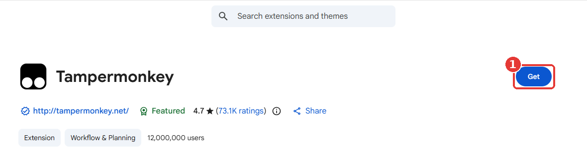
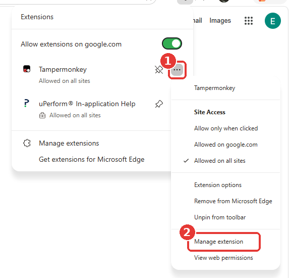
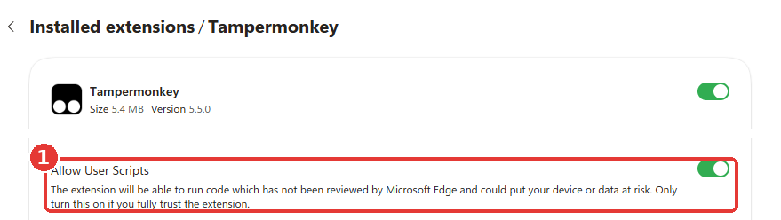
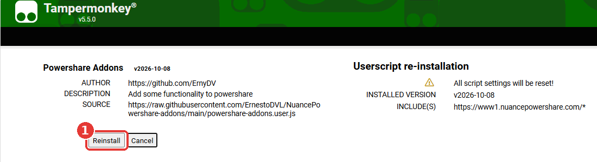
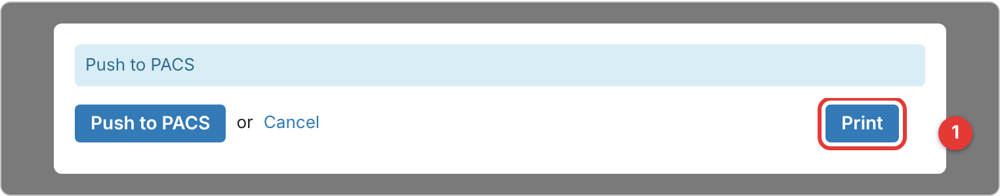
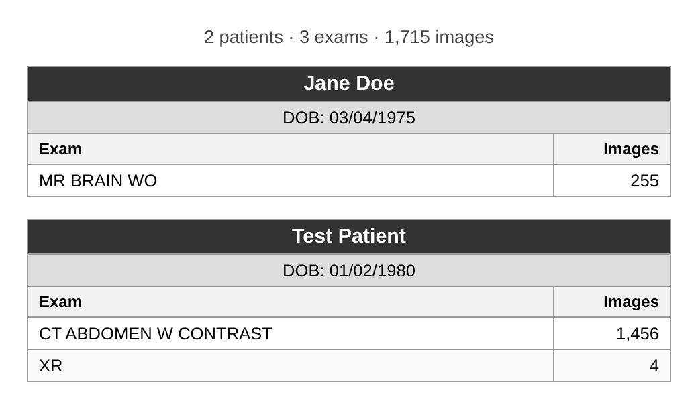

# Powershare Addons

A Tampermonkey userscript that adds a few time-saving shortcuts to [Nuance PowerShare](https://www1.nuancepowershare.com/).

**[Install Powershare Addons](https://raw.githubusercontent.com/ErnestoDVL/NuancePowershare-addons/main/powershare-addons.user.js)** (Tampermonkey must be installed first, see [How to install](#how-to-install))

## Features

| Feature | Where | What it does |
| --- | --- | --- |
| **Select All** | PACS page, actions menu | Selects every nomination in the list with one click. |
| **Type a date of birth** | Advanced Image Search | Lets you type into the Date of Birth box instead of using the calendar picker. |
| **Print exam list** | Push to PACS window | Prints one small table per patient: name, date of birth, then each exam (modality and description) with its number of images. |

## How to install

You do this once on each computer, in the browser you use for Powershare (Google Chrome or Microsoft Edge). It takes about 5 minutes. The steps are the same in both browsers, and only a few button names differ. In each picture, the red numbers show where to click, in order.

### Step 1 – Add Tampermonkey to your browser

Tampermonkey is a free, widely used browser add-on that runs small scripts like this one.

1. Open the Tampermonkey page: [Tampermonkey on the Chrome Web Store](https://chromewebstore.google.com/detail/tampermonkey/dhdgffkkebhmkfjojejmpbldmpobfkfo). This link works in both Chrome and Edge.
2. Click the blue **Get** button on the right. In Chrome, the button says **Add to Chrome**.

   

3. A box pops up asking to add Tampermonkey. Click **Add extension**.

### Step 2 – Allow Tampermonkey to run scripts

Your browser doesn't let add-ons run scripts until you switch this on. Without it, nothing will happen in Powershare.

1. Click the **puzzle-piece icon** at the top right of your browser, then click the **three dots** next to Tampermonkey (1).
2. In the menu that opens, click **Manage extension** (2).

   

3. On the page that opens, find **Allow User Scripts** and click the switch so it turns on. You can then close that tab.

   

If the switch is greyed out and won't move, your computer is locked down by IT. Ask IT to allow Tampermonkey user scripts, then come back to this step.

### Step 3 – Install the Powershare Addons script

1. Click this link: **[Install Powershare Addons](https://raw.githubusercontent.com/ErnestoDVL/NuancePowershare-addons/main/powershare-addons.user.js)**
2. A Tampermonkey page opens showing **Powershare Addons** and its details. Click **Install**. If you already have the script, the button says **Reinstall** instead.

   

3. Go to Powershare and refresh the page. The script is now active. You'll see a **Select All** link on the PACS page.

You never need to reinstall. Tampermonkey checks this repository about once a day and installs new versions automatically.

## How to use it

### Select all nominations

On the PACS page, click **Select All** in the actions menu. Every nomination in the list is selected at once, instead of ticking each box.

### Type a date of birth in Advanced Image Search

In **Advanced Image Search**, click the **Date of Birth** box once. You can now type the date (for example `01/02/1980`) instead of scrolling through the calendar.

### Print the exam list

Always print **before** you push. The Print button disappears once the push goes through.

1. On the PACS page, select the nominations you want (or click **Select All**).
2. Click **Push to PACS**. A window opens over the page listing every selected exam.
3. At the bottom of that window, click **Print**, to the right of **Push to PACS** / **Cancel**.

   

4. Your browser's print screen opens right away, with no new tab. The preview shows one small table per patient: name, date of birth, then each exam (modality and description) with its number of images. Patients are in alphabetical order, and a patient's exams are always grouped in one table.

   

5. Choose your printer and click **Print**. You stay in the Push to PACS window.
6. Click **Push to PACS** as usual.
